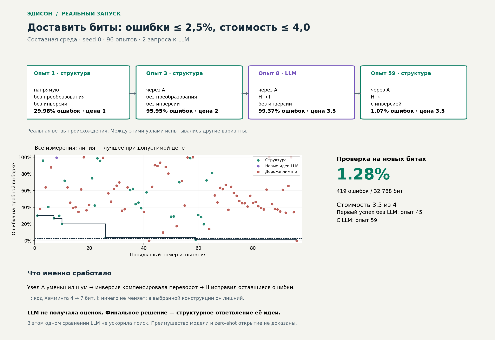

# EdisonResearch

Эдисон — проект исследовательской системы с независимой генерацией идей и
экспериментальной памятью. Реализованы стенд переоткрытия механизмов и структурный
прототип генерации ветвей. Адаптер OpenRouter проверен живыми запросами.
Преимущество генератора и zero-shot способность пока не установлены.

[Побитовая анимация реального опыта: входы, код, промежуточные значения](docs/edison-trace.html) ·
[Общая схема в HTML](docs/edison-animatic.html) ·
[Анимационный разбор принципа — MP4, 80 секунд](docs/edison-explained.mp4) ·
[Плеер с главами](docs/edison-animation.html) ·
[Раскадровка](docs/edison-animation-storyboard.jpg).
Русские подписи, без озвучки. Пересобрать: `python scripts/animate_edison.py`
(Pillow, FFmpeg и шрифты DejaVu Sans).

## Сталкер и учёный-тестер

[Проект следующей архитектуры: Сталкер исследует состав, среды и связи](docs/structural-stalker.md).
Это проект контракта; текущий Сталкер пока подключает готовые битовые компоненты.

Добавлен экспериментальный [LLM-учёный](docs/llm-scientist.md): модель сама
формулирует конкурирующие гипотезы, пишет опыты и пересматривает объяснения по
измерениям. После перехода на строгий JSON Schema живые опыты дали 10 измерений
неизвестной функции, 14 битового преобразователя и 20 физической системы.
В [живом повторе v3](docs/llm-scientist.md#живой-повтор-v3) получены 38 измерений,
все воспроизведены. Битовый стенд прошёл полностью; на функции и физике вторые
раунды снова оборвались даже при 8192 токенах. Все три обзора завершились.

Режим `--discover` начинает с пустого каталога. Сталкер находит сущности в локальном
инфополе и подключает их; отдельный учёный-тестер ставит опыты над компонентами,
сохраняет свойства, область проверки и исходные свидетельства. При появлении
нового инструмента ответвления получают и ранее раскрытые узлы графа.
Накопленные знания можно сохранить и загрузить без повторного изучения.

```bash
mkdir -p artifacts
python -m edison.pipeline --discover --provider openrouter --budget 192 --model-calls 4 > artifacts/discovery-openrouter.json
```

Проверено: 4 обнаруженные сущности, 218 опытов компонентов, 14 подтверждённых
свойств, 4/4 ответа OpenRouter; составная задача решена. Все 43 теста прошли.
Сталкер пока использует локальный источник, а учёный — фиксированные семейства
проб. Знания хранятся отдельно и не передаются генератору комбинаций.
[Архитектура, результаты, ограничения и загрузка базы знаний](docs/discovery.md).
[Иллюстрация Сталкера и учёного](docs/stalker-scientist.png) ·
[Интерактивный просмотр опытов над компонентами](docs/stalker-scientist.html).

## Наглядный разбор первого запуска (до добавления обнаружения)



[Интерактивная страница со всеми 96 опытами](docs/edison-run.html) — скачайте HTML
и откройте в браузере. Она работает без сети: можно выбирать опыт, смотреть
конструкцию, ошибки и стоимость, включать проигрывание и приближать график.
[Данные визуализации](reports/edison-run-data.json) получены из журналов запуска.

Важное уточнение происхождения: итоговая конструкция не была напрямую предложена
LLM, но является структурным ответвлением её идеи. Соседний вариант с инверсией
создавался без доступа к оценкам. Первый проходящий вариант появился на 59-м опыте
с LLM и на 45-м без неё. Это одно сравнение; ускорение от модели здесь не показано.

Пересобрать визуализацию: `python scripts/visualize_run.py`. Скрипт использует исходные
журналы, если они есть, иначе сохранённые данные. Для PNG нужен Matplotlib;
`--no-png` собирает HTML без внешних зависимостей. Запросов к модели скрипт не делает.

## Запуск

Python 3.10+, без внешних зависимостей, ключей и сетевых сервисов. Из корня:

```bash
python -m unittest discover -s tests -v
mkdir -p artifacts
python -m edison.benchmark --seeds 3 --budget 24 > artifacts/baseline.jsonl
python -m edison.research --seeds 3 --budget 96 > artifacts/composition.jsonl
python -m edison.pipeline --provider none --budget 96 > artifacts/process-baseline.json
```

Полный контрольный перебор: `python -m edison.benchmark --seeds 3 --budget 36`.
JSONL содержит условия запуска, полный журнал пробных опытов, выбранную конструкцию,
ошибки на пробной и контрольной выборках, стоимость и успех. `artifacts/` игнорируется Git.
Те же аргументы воспроизводят результат; `--seed-start` выбирает новые миры.

## Отдельный испытатель и OpenRouter

`edison.pipeline` запускает испытатель через `multiprocessing` в режиме `spawn`.
Законы мира, seed и экспериментальная память находятся в дочернем процессе.
Протокол предоставляет каталог действий, пробный опыт и единственную финальную
проверку. Выбор финального кандидата выполняет испытатель по пробным наблюдениям;
запросить произвольные контрольные выборки через этот протокол нельзя.

Внешний генератор запускается отдельной командой с новым контекстом на каждый
запрос. На входе JSON: задача, родительская конструкция, доступные примитивы и
схема ответа. История опытов, оценки, seed и семейство мира ему не передаются.
Ответ содержит не более восьми конструкций, строго проверяется как данные и
не исполняется как код. Повторы сохраняют связи происхождения без нового опыта.

Предложения генератора могут занять каждый второй опыт; остальные ходы принадлежат
FIFO. Предложенные им конструкции тоже остаются в общей очереди. Это фиксированное
правило чередования, без агента-планировщика и исключения ветвей по качеству.
Конечный лимит вызовов генератора не ограничивает продолжение структурного поиска.

Настройки OpenRouter:

* `OPENROUTER_API_KEY` — секрет, вводится через настройки среды.
* `EDISON_MODEL` — идентификатор модели; по умолчанию `openai/gpt-4.1-mini`.
* HTTPS-адрес API фиксирован: `https://openrouter.ai/api/v1/chat/completions`.

После настройки ключа и сети:

```bash
python -m edison.pipeline --provider openrouter --profile combined --budget 96 --model-calls 4 > artifacts/openrouter.json
```

На один запрос выделено до 4096 токенов завершения, включая рассуждение модели;
для reasoning задан уровень `low`. Использование токенов записывается,
если API возвращает его. Четыре вызова — лимит числа запросов, не денежный лимит.
Задание не содержит примеров решений; генератор не получает предыдущие диалоги.
Это ещё не исключает знания механизма из предобучения.

Журнал содержит запросы, их хеши, принятые предложения, статистику токенов, ошибки,
граф и итоги. `generator_status` различает отключённый, успешный, частично успешный
и отказавший генератор; `model_calls_succeeded` и `model_origin_tested` показывают,
были ли получены ответы и испытаны новые идеи. При отказе провайдера FIFO продолжает
работать. Успех задачи в таком запуске не означает успех подключения модели.
Без ключа CLI с `--provider openrouter` завершается с явной ошибкой.

Команда OpenRouter использует стандартную проверку TLS, ограничение времени и
фильтр окружения: ключ провайдера, имя модели, системный путь, настройки локали,
прокси и доверенных сертификатов. Произвольные переменные среды ей не передаются.
Полные диагностические сообщения провайдера не копируются в журнал; сохраняются
категории ошибок и HTTP-коды. Для выполнения не нужны дополнительные пакеты.

Граница процессов не является песочницей файловой системы: доверенный адаптер
работает от того же пользователя и технически может читать доступные ему файлы.
Недоверенный агент с инструментами чтения файлов потребует отдельного контейнера
или ОС-изоляции. Текущий адаптер выполняет фиксированный HTTP-запрос, без инструментов
файлового доступа для LLM. Модель получает только явно сформированный JSON.

Текущий статус подключения: в работающей среде доступны `OPENROUTER_API_KEY`
и `EDISON_MODEL`, каталог OpenRouter отвечает HTTP 200. Настроенная модель найдена
в каталоге и поддерживает параметр reasoning. Живое подключение проверено.

Проверка реализации: все 31 тест прошёл. Проверены реальный запуск внешней
команды через JSON-протокол, отдельный процесс испытателя, совпадение результатов
с исходным симулятором, сохранение соседних ветвей, фильтрация окружения, ошибки,
таймауты и HTTP-запрос OpenRouter с имитацией ответа. Локальный запуск отдельного
испытателя решил составной мир seed 0 за бюджет 96 опытов; результат сохранён в
`artifacts/process-baseline.json`.

Живая проверка OpenRouter: первый запуск дал два корректных ответа из четырёх.
В диагностическом запросе подтверждён `finish_reason=length`: reasoning-модель исчерпала
прежний лимит 1200 токенов до выдачи JSON. После увеличения лимита до 4096 и выбора
`reasoning.effort=low` повторный запуск дал 2/2 корректных ответа; четыре новые идеи
модели испытаны среди 96 опытов. Составной мир seed 0 решён: 419 ошибок из 32768 бит
(около 1.28%) при стоимости 3.5 и пределе 4.0.

Выбранное решение не было предложено моделью. Этот запуск подтверждает работу
подключения и испытание идей LLM, но не её преимущество над структурным поиском
и не zero-shot переоткрытие. Числовой отчёт без ключей и полных ответов API:
[`reports/openrouter-live.json`](reports/openrouter-live.json).

## Конструкции и ветви

Новый контур `edison.research` строит маршрут из промежуточных узлов, цепочку
преобразований и число повторных передач. Длина маршрута, глубина преобразований
и нечётное число повторов не ограничены константой в генераторе. Пространство
счётно бесконечно **в пределах этой грамматики**, а не охватывает любые изобретения.

* `Generator` получает только конструкцию и идентификаторы доступных примитивов.
  Ему не передаются наблюдения, рейтинги, семейство мира или оценки стоимости.
* `IdeaGraph` хранит уникальные конструкции и все обнаруженные связи происхождения,
  включая возвраты к прежним узлам. Равенство структурное; семантически эквивалентные
  программы автоматически одинаковыми не считаются.
* `Branches` с методом `fair` обслуживает очередь FIFO. Новые дети становятся в конец;
  соседние ветви и прежние основания сохраняются независимо от результата опыта.
* `ExperimentMemory` отдельно хранит результаты и выбирает итоговую конструкцию.
  Возврата оценок в генератор или очередь нет.

При конечном числе детей и завершающейся генерации FIFO когда-нибудь обслужит
каждую зарегистрированную конструкцию, если работа продолжается неограниченно.
Конечный бюджет оставляет необработанные идеи в `graph.pending`. Это гарантия
очередности, а не доказательство эффективности: текущий генератор структурный,
поиск фактически перечислительный. Выбора «интересного» по содержанию пока нет.
Метод `random` случайно выбирает узел той же растущей очереди для сравнения.

Симулятор `CompositionWorld` использует отдельные звенья, вложенные преобразования
с дополнением блоков и обратным декодированием. К четырём исходным семействам
добавлено `combined`: нужно совместить узел, преобразование и инверсию. Удаление
любого из этих трёх элементов проверено отдельным тестом и ломает решение.
Изобретение самого кода Хэмминга остаётся вне текущей грамматики.

Число уникальных попыток и сообщений на опыт одинаково у двух методов. Расход
реальных передач учитывается отдельно. Лимит исполнения одного опыта — 2 000 000
битовых передач по звеньям: превышение записывается как `resource_limit`, без
ложной оценки качества и без удаления идеи из графа. Лимит действует и на контрольную
проверку. Это ограничение исполнения, не заключение о невозможности конструкции.

JSONL содержит полный граф, очередь оставшихся идей, наблюдения, расход передач,
выбранную конструкцию и единственную контрольную проверку. `attempts`, `executed`
и `resource_limited` различаются. Журнал пока не является автоматически загружаемой
контрольной точкой для продолжения запуска.

`edison.research` сохраняет исходный вариант в одном процессе. Новый
`edison.pipeline` разделяет процессы, как описано выше. Структурный прототип
не доказывает zero-shot способность LLM.

Проверка нового контура: seed 0–2, бюджет 96, пять семейств, 512 пробных и 8192
контрольных сообщений. FIFO решил 15/15 задач, случайный выбор из очереди — 13/15;
в составном семействе соответственно 3/3 и 1/3. Во всех 30 запусках было ровно
96 уникальных опытов, без повторного испытания одной конструкции; необработанные
ветви остались в журнале. Лимит исполнения в этих запусках не срабатывал.
Все 18 тестов прошли, включая неизменность генерации при изменении наблюдений,
покрытие всех конструкций до глубины 3 и сохранение разных путей происхождения.
Это малая проверка работоспособности, не статистический вывод о превосходстве.
Контрольная выборка меняет сообщения и шум, но не законы данного мира; перенос
на другие законы отдельно пока не проверяется. Полный журнал: `artifacts/composition.jsonl`.

## Первый эксперимент

Передать четырёхбитные сообщения с долей ошибочных битов ≤ 0.025 при ограничении
стоимости одного исходного бита: число звеньев × повторы × расширение кодирования.

Три маршрута, два преобразователя, повторения 1/3/5 и инверсия перед декодированием
дают 36 конструкций. Идентификаторы случайные; свойства скрыты от поиска.
Маршруты фиксированы, а не собираются агентом из отдельных узлов.

| Семейство | Механизм, достаточный для решения |
| --- | --- |
| Повторение | Голосование по повторным передачам |
| Промежуточный узел | Два надёжных звена вместо одного шумного |
| Кодирование | Исправление ошибки кодом Хэмминга (7,4) |
| Неизвестное свойство | Компенсация инверсии сигнала |

Это небольшие параметризованные семейства с заранее встроенными решениями.
Кодирование предоставлено как неизвестный преобразователь: можно обнаружить его
полезность, но изобрести сам код Хэмминга в этом пространстве нельзя. Инверсия также
задана оценщиком. Стенд не доказывает способность создавать неизвестные человечеству
механизмы или самостоятельно расширять пространство идей.

## Протокол

`edison.protocol.Session` предоставляет каталог и `probe(candidate)`: ошибки,
объём выборки, стоимость. Точный повтор возвращает прежнее наблюдение без нового
расхода бюджета. Контролируемые репликации опыта пока не поддерживаются.

`finalize(candidate)` проверяет один испытанный вариант на отдельном потоке сообщений
и шума, затем закрывает сессию. Успех требует одновременно точности и допустимой
стоимости. Семейство и параметры мира поиску не передаются. Разделение API внутри
процесса не защищает от чтения исходников или приватных атрибутов. Для LLM нужен
отдельный процесс оценщика без доступа агента к его файлам и контрольным seed.

По умолчанию 512 пробных и 8192 контрольных сообщений. Порог на конечной выборке
не является статистическим доказательством надёжности. Для серьёзного сравнения
нужны независимые миры и интервалы неопределённости.

## Контрольные методы

* `random`: случайный порядок без повторений.
* `breadth`: все маршруты/преобразователи при малом числе повторений, затем следующие
  уровни. Наблюдения не исключают ветви и не меняют порядок генерации.

Одинаковы каталог, бюджет уникальных опытов и число сообщений на опыт. Финальный
выбор: соблюдение стоимости, минимальная ошибка, затем стоимость. Физическая
стоимость испытанных передач может различаться. Бюджет 36 исчерпывает пространство;
24 позволяет сравнить порядок. `probe_transmitted_bits` учитывает суммарную стоимость
передач в пробных опытах (контрольная проверка не включена).
Эти два метода относятся к исходному конечному стенду. Новый контур ветвления
и отдельная память описаны выше; полного исследователя с рассуждением ещё нет.

## Zero-shot

Для будущего Эдисона: без примеров решений и настройки на проверочные миры;
эксперименты внутри попытки разрешены. Между независимыми попытками память
сбрасывается, перенос знаний проверяется отдельно. Здесь нет LLM, поэтому результаты
не устанавливают zero-shot способность модели. Переименование объектов само по себе
не исключает знания из предобучения.

Следующий этап: сравнить живые запуски OpenRouter с запусками без модели
при одинаковом бюджете на множестве миров. Затем отдельно сравнить независимую генерацию
с вариантом, получающим экспериментальные оценки, на новых закрытых мирах.
LLM не должна иметь право закрывать структурные ветви. Ключи и сеть нужны только
при выборе OpenRouter; все структурные проверки остаются полностью локальными.

## Первая проверка стенда

Python 3.12.14, seed 0–2, четыре семейства, 512 пробных и 8192 контрольных сообщений:

| Метод | Бюджет 24 | Полный бюджет 36 |
| --- | --- | --- |
| Случайный порядок | 10/12 успешных попыток | 12/12 |
| Обход по уровням | 12/12 | 12/12 |

Все 8 автоматических тестов прошли, включая коррекцию каждой одиночной ошибки
для всех 16 входных слов, ограничения бюджета, контрольную проверку и влияние
целевых механизмов. Один полный запуск воспроизведён с идентичным журналом.
Журналы текущего запуска: `artifacts/baseline.jsonl` и `artifacts/exhaustive.jsonl`.
Три seed — проверка работоспособности стенда, не доказательство превосходства метода.
