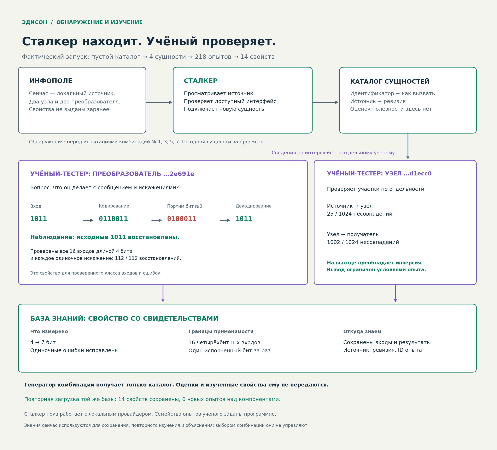

# Сталкер и учёный-тестер

Рабочий режим `--discover` начинается с **пустого каталога**, а не с заранее
выданных генератору двух узлов и двух преобразователей. Сталкер обнаруживает
сущности в отдельном локальном источнике и подключает их по интерфейсу.
Учёный-тестер изучает компоненты независимо от испытаний целых конструкций.



[Интерактивная иллюстрация](stalker-scientist.html): скачайте HTML и откройте
в браузере. Можно выбирать четырёхбитный вход, позицию искажения и преобразователь,
сравнивать участки узлов. Показываются сохранённые опыты, без новых запросов API.
Пересобрать из отчётов: `python scripts/visualize_discovery.py` (для PNG нужен Matplotlib).


Оценки комбинаций и база свойств не возвращаются генератору. Сейчас знания
используются в карточках компонентов и связях отчёта; они **не управляют порядком
комбинаций**. Направленный выбор новых исследований по накопленным знаниям ещё
не реализован. Это не замаскировано под ускорение поиска.

## Сталкер

`edison.stalker.Stalker` обращается к интерфейсу источника: страница кандидатов →
описание сущности → подключение. В записи есть идентификатор, вид интерфейса,
источник и ревизия. Свойства, вероятности ошибок и название реализации не выдаются.
Неподдерживаемые сущности сохраняются со статусом, а не объявляются невозможными.
При повторном просмотре известные сущности не импортируются заново; источник
периодически пересматривается, поэтому новые записи можно обнаружить позднее.

`edison.infopole.InfoField` — текущий **локальный конечный провайдер**: четыре
сущности исходного симулятора. Он не ищет в интернете, не устанавливает пакеты
и не создаёт новые инструменты. `publish_transform` позволяет доверенному
провайдеру добавить новый адаптер. В тесте после первого сканирования добавлен
неизвестный учёному преобразователь: Сталкер обнаружил его, учёный изучил, затем
он действительно использовался в передаче. Это проверяет расширение каталога,
а не способность добывать сущности из произвольных источников.

`Branches.update_primitives` добавляет варианты с новым инструментом **также
к ранее раскрытым узлам графа**. Старые ветви остаются в очереди. Исчезновение
сущности из очередной страницы источника не удаляет её из среды задачи.

## Учёный-тестер

`edison.scientist.Scientist` видит публичный интерфейс экспериментов, но не
`CompositionWorld`, реализацию кодека или параметры канала. Сейчас он использует
фиксированные семейства чёрноящичных проб:

| Интерфейс | Опыты | Сохраняемые наблюдения |
| --- | --- | --- |
| Преобразователь | Все 16 четырёхбитных входов без шума | Длина выхода, обратимость, совпадение выхода с входом |
| Преобразователь | Один восьмибитный пример | Длина выхода только для этого примера |
| Преобразователь | Все четырёхбитные входы, каждое одиночное искажение закодированного бита | Число точных восстановлений / число испытаний |
| Узел | Источник→узел и узел→получатель; по два разных сбалансированных 512-битных шаблона | Доля несовпадений, 95% интервал Уилсона, преобладающее сохранение или инверсия |

Для случайного канала реплики используют разные потоки шума. Повтор точно того же
запроса возвращает сохранённое наблюдение; новая реплика задаётся явно.
Факты сохраняют область проверки, источник, ревизию и ссылки на исходные входы,
искажения и результаты. При исчерпании бюджета исследование получает `deferred`:
неисполненная проверка не превращается в положительный факт. Генератор при этом
сохраняет доступ к сущности, даже если её свойства ещё неизвестны.

Это испытатель с запрограммированными семействами опытов, не LLM-учёный,
самостоятельно изобретающий протоколы исследования. Название «код Хэмминга» он
не угадывает: результат — измеренное расширение сообщения и восстановление ошибок.
Поведение на других размерах входа и нескольких одновременных ошибках остаётся
неизученным, кроме явно записанного восьмибитного примера.

## Фактический запуск

В составном мире seed 0 обнаружения произошли перед опытами комбинаций 1, 3, 5, 7.
Бюджеты компонентов и комбинаций считаются раздельно:

* 4 сущности подключены из пустого каталога;
* 218 уникальных опытов компонентов, 5334 обработанных ими бита;
* 14 фактов с исходными экспериментальными свидетельствами;
* 192 испытания комбинаций; это не сравнение с прежним бюджетом 96;
* живой OpenRouter: 4/4 корректных ответа, 10 новых предложений испытаны;
* итог на отдельных 32768 битах: 467 ошибок, около 1,43%, стоимость 3,5 при пределе 4;
* все 43 автоматических теста прошли; отдельно проверен профиль coding / seed 1.

Примеры изученных свойств:

| Сущность | Что измерено |
| --- | --- |
| Преобразователь с выходом 7 бит | 16/16 чистых восстановлений, 112/112 восстановлений после одиночной ошибки |
| Преобразователь с выходом 4 бита | Выход совпадает с входом; 0/64 восстановлений после одиночной ошибки |
| Один узел, входной участок | 25 несовпадений из 1024 бит, преобладает сохранение сигнала |
| Тот же узел, выходной участок | 1002 несовпадения из 1024 бит, преобладает инверсия |

Числовой отчёт: [discovery-run.json](../reports/discovery-run.json).
База с 218 исходными свидетельствами: [discovery-knowledge.json](../reports/discovery-knowledge.json).
Исследовательские потоки шума отделены от шума комбинационных опытов и контрольной
выборки. Обобщение на новые физические законы и преимущество по затратам не доказаны.

## Запуск и повторное использование знаний

Из корня репозитория, без внешних зависимостей:

```bash
mkdir -p artifacts
python -m edison.pipeline --discover --provider none --budget 192 --knowledge-out artifacts/knowledge.json > artifacts/discovery.json
python -m edison.pipeline --discover --provider openrouter --budget 192 --model-calls 4 > artifacts/discovery-openrouter.json
```

После первого запуска можно загрузить ту же базу:

```bash
python -m edison.pipeline --discover --provider none --budget 192 --knowledge-in artifacts/knowledge.json > artifacts/reused.json
```

Проверен отдельный повторный запуск: сохранены все 14 фактов, **0 новых опытов
компонентов**. Совпадать должны идентификатор, источник и ревизия; знания другой
сущности или ревизии не считаются её свойствами. База — доверенный локальный
журнал, а не криптографическое доказательство достоверности измерений. При изменении
законов или адаптера провайдер обязан менять ревизию. JSON загружается как данные,
адаптеры из него не исполняются.

Входные примитивы и физика остаются внутри отдельного процесса испытателя.
Разделение процессов по-прежнему не является ОС-песочницей для недоверенного кода.
