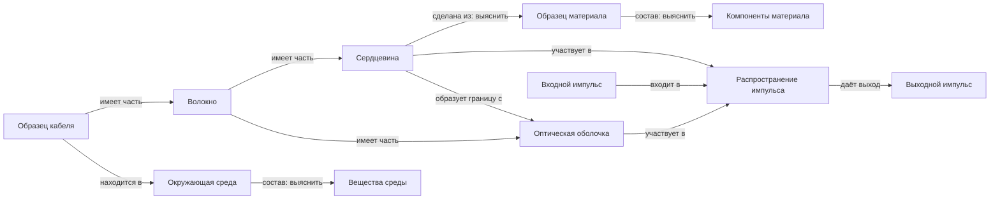

# Сталкер как исследователь структуры и связей

Статус: проект новой архитектуры. Это не описание возможностей текущего кода.
Существующий `Stalker` обнаруживает и подключает два вида битовых компонентов;
рекурсивного исследования частей, материалов, сред и процессов в нём нет.

## Сущность и утверждение о ней

Сущность — устойчиво адресуемый предмет рассмотрения, который можно различать,
на который можно ссылаться и о котором можно получать сведения. Исполнимый
интерфейс для включения в каталог сущностей не обязателен.

Объектом рассмотрения могут быть конкретный образец, конструкция, тип материала,
процесс, среда, граница между средами, метод измерения или само понятие свойства.
Это примеры, а не закрытый список допустимых типов. Типы и отношения могут
появляться и уточняться в ходе исследования.

Идентичность, структура и доступные действия — разные записи:

* Сущность: на что ссылаемся; источник идентификации и границы объекта.
* Утверждение: что предполагается, сообщается источником или наблюдается о ней.
* Возможность взаимодействия: каким доверенным инструментом можно получить
  данные, изменить условия или включить сущность в исполнимую конструкцию.

Состав и тип сущности не следует превращать в неизменяемые поля паспорта:
«это стекло», «эта часть входит в кабель» и «эти объекты эквивалентны» — тоже
проверяемые утверждения с происхождением, версией и областью действия.

Нужно различать конкретный экземпляр кабеля, модель кабеля и класс конструкций.
Аналогично, образец материала отличается от понятия «кварцевое стекло».
Утверждения об экземпляре не переносятся на весь класс автоматически.

Значение температуры 20 °C обычно записывается как условие опыта. Прибор,
измерение температуры и понятие температуры могут получить собственные ссылки,
если над ними возникает отдельный исследовательский вопрос. Отдельный узел на
каждое слово или число не требуется.

## Граф, а не единственная иерархия

У одного объекта могут быть несколько разбиений, выбранных по разным основаниям:
геометрическому, производственному, химическому, функциональному. Они сосуществуют.
У каждого разбиения сохраняются метод выделения, масштаб и контекст. «Часть»,
«материал», «участник процесса» и «находится в» не заменяют друг друга.

Иллюстративная схема для образца кабеля; это не результат его исследования:



Участие процесса удобно хранить через роли: вход, выход, среда, участник,
инструмент. Так утверждение может связывать несколько сущностей, а не только
одну пару. Связь и разбиение тоже могут становиться предметом исследования.

Новые названия отношений допустимы. Их смысл, единицы и совместимость требуют
явного описания; неизвестное название не является доказательством невозможности.

## Три исследовательских цикла

| Цикл | Вопрос | Результат |
| --- | --- | --- |
| Сталкер структуры | Что здесь есть, из чего состоит, с чем связано, что окружает, в каких процессах участвует? | Новые сущности, гипотезы связей, источники, открытые вопросы |
| Учёный свойств | Как это ведёт себя при заданных условиях и вмешательствах? | Измерения и объяснения с областью действия |
| Генератор и испытатель комбинаций | Какие конструкции предложить и что происходит при их испытании? | Независимые предложения, журнал испытаний и ветви |

Сталкер получает обратную связь собственных структурных исследований. Учёный
свойств может передать ему открытый вопрос, например: «результат зависит от
неучтённой части или среды». Такие вопросы не являются готовыми ответами.
Новое обнаруженное отношение, в свою очередь, создаёт вопросы о свойствах.

Контекст генератора комбинаций сохраняется отдельным. В него поступает проекция
доступных примитивов и контрактов действий; полный граф исследовательских
утверждений, история измерений и оценки комбинаций не передаются. Новый объект
графа не становится исполнимым примитивом автоматически.

## Протокол структурного исследования

1. Сталкер выбирает открытый вопрос из сохраняемой очереди. Объект может быть
   целым, частью, материалом, средой, процессом или неясной связью.
2. LLM формулирует альтернативные структурные гипотезы, выбирает доступное действие
   и указывает, какие данные различили бы объяснения. Например: «сердцевина
   однородна» / «содержит различимые слои или неоднородности».
3. Доверенный инструмент выполняет действие: читает конкретный документ, ищет
   источник, получает снимок с прибора, изучает сечение, проверяет внешние связи.
   Доступные действия зависят от подключённых адаптеров.
4. Сохраняется исходный результат с адресом источника, версией, временем и методом
   получения. Текст источника и наблюдение прибора имеют разное происхождение.
5. LLM предлагает новые сущности, отношения и разбиения, ссылаясь на конкретные
   фрагменты результата. Парсер проверяет структуру и существование ссылок;
   семантическую истинность этим не устанавливает.
6. Кандидаты записываются в граф. Название, придуманное моделью, само по себе не
   доказывает существование объекта. Утверждение из документа сохраняется как
   сообщение документа; измерение — как наблюдение; обобщение — как гипотеза.
7. Для новых объектов и связей появляются вопросы. Для прежних объектов могут
   появиться новые разбиения и альтернативные объяснения. Цикл повторяется.

Разведка включает движение внутрь объекта, к окружающему контексту, к процессам,
к соседним связям и к альтернативным представлениям. Это расширяемые направления,
а не закрытая онтология, заранее перечисляющая все возможные сущности.

При исчерпании возможностей статус вопроса — «нет источника», «нет инструмента»
или «отложено по бюджету». Отсутствие ответа не доказывает отсутствие сущности.

## Конкретная последовательность для кабеля

Это сценарий будущего исследования. Документы, приборы и ответы для него пока
не подключены; ниже нет заявления о реально измеренном составе кабеля.

| Шаг | Что получает Сталкер | Что добавляет или уточняет | Следующий вопрос |
| --- | --- | --- | --- |
| 1 | Ссылка на конкретный образец и его документацию | Идентичность образца; связь с моделью изделия | Какие структуры различимы в этом образце? |
| 2 | Документ или наблюдение сечения | Кандидаты на части и способ разбиения: волокна, покрытия, несущие элементы — только если они обнаружены | Из чего сделана каждая найденная часть? |
| 3 | Сведения о составе сердцевины | Связь с материалом; при наличии основания — компоненты и примеси | Однороден ли материал? Меняется ли состав вдоль образца? |
| 4 | Данные об установке кабеля | Связи с окружающей средой, соседними объектами и границами | Какие вещества и состояния среды взаимодействуют с кабелем? |
| 5 | Данные о прохождении импульса | Процесс с ролями входа, выхода и среды; соответствующие части | Что влияет на форму и время прихода импульса? |
| 6 | Противоречие прежнему описанию или новое наблюдение | Альтернативное разбиение либо новая гипотеза связи | Нужен ли более мелкий масштаб, иной метод или проверка источника? |

Если источник действительно указывает кварцевое стекло и добавки, это становится
основанием исследовать их отдельно. Вносить такой состав заранее из общего
представления о «типичном кабеле» нельзя. Другой образец может иметь другой
состав, иное строение или полые области.

Переход к более мелкому масштабу не требует перечислить все атомы: можно
исследовать распределение, типы компонентов или представительный участок.
При этом сам выбор участка и пределы вывода сохраняются. Универсального заранее
заданного «последнего уровня дробления» нет.

## Состояние знания и тождество

Каждое утверждение содержит:

* участников и их роли;
* отношение либо утверждаемое свойство;
* условия, масштаб, версию объекта и время, когда это существенно;
* происхождение: кто и каким способом получил исходные данные;
* ссылки на данные;
* статус: предложение, сообщение источника, наблюдение или интерпретация;
* связи с поддерживающими и противоречащими записями.

Эти статусы — категории происхождения, а не линейная лестница доказанности.
Измерение тоже может содержать ошибку; согласие нескольких источников не равно
независимому подтверждению. Проверка метода и воспроизводимость учитываются
отдельно. Число уверенности LLM не заменяет экспериментального основания.

Сущности из разных источников не склеиваются только по одинаковому названию.
Предполагаемое тождество хранится как отдельная связь. До проверки можно
сохранить две записи и исследовать их соответствие. Противоречащие сведения
не перезаписывают друг друга.

Смена состояния физического образца не обязательно создаёт новый объект, но
меняет условия применимости наблюдения. Ревизия реализации инструмента и
состояние образца должны учитываться раздельно. Кэширование наблюдений
допускается лишь при явно описанной семантике повтора.

## Очередь без отбрасывания направлений

Нужна сохраняемая граница исследования: вопросы, позиции просмотра источников,
альтернативы и отложенные действия. Любой выбранный на текущий ход приоритет
не удаляет остальные вопросы.

Простой начальный механизм, аналогичный существующему поиску комбинаций:
каждый второй ход обслуживает FIFO, остальные могут обслуживать предложения LLM.
Это правило очереди, а не агент, решающий, какие направления «вообще возможны».
Новый источник, инструмент, состояние или отношение может снова открыть вопрос
у уже просмотренного объекта.

Повторы различаются по объекту, контексту, версии источника, действию и параметрам.
Два одинаковых названия не означают одинаковые вопросы. Ответ из кэша не следует
выдавать за новый независимый опыт.

Если зарегистрированные вопросы обрабатываются за конечное время, новые
вопросы поступают конечными порциями и источник доступен, FIFO позволяет
обслужить каждый зарегистрированный вопрос при бесконечном исполнении.
Это не доказывает обнаружение всех существующих сущностей: полнота источников,
возможностей измерения и предложений модели остаётся отдельной проблемой.

## Предлагаемый контракт расширения

Провайдер публикует ресурсы, а не только готовые исполнимые компоненты:

```text
discover(cursor)                   → ссылки на доступные ресурсы
describe(resource_ref)             → идентичность, версия, доступные действия
invoke(action_ref, arguments)      → исходный результат и происхождение
```

Результат структурной интерпретации отдельно:

```json
{
  "new_entities": [
    {
      "local_id": "candidate-core",
      "description": "Область образца, выделенная выбранным методом",
      "identity_basis": ["observation-17:region-A"]
    }
  ],
  "assertions": [
    {
      "relation": "part_of",
      "participants": {
        "part": "candidate-core",
        "whole": "sample-42"
      },
      "context": {
        "decomposition": "cross-section-view-1"
      },
      "evidence_refs": ["observation-17:region-A"],
      "status": "proposed"
    }
  ],
  "open_questions": [
    {
      "target": "candidate-core",
      "question": "Из чего состоит эта область и однородна ли она?"
    }
  ]
}
```

Это иллюстрация будущего формата, не действующий API и не реальное observation-17.
Новые отношения допускаются, но должны получить описание. Возможность исполнения
конструкций подключается отдельным контрактом действий и совместимости; граф
не выдаёт экспериментальных возможностей, которых нет у адаптера.

## Порядок реализации и критерии проверки

1. Граф ссылок, утверждений, контекстов и происхождения. Проверить разные
   разбиения одного объекта, противоречия и отсутствие автоматического склеивания.
2. Сохраняемая очередь структурных вопросов и протокол источников. Проверить
   возврат к старому объекту после появления новых данных и сохранение широты.
3. LLM-цикл Сталкера: вопрос → действие → исходные данные → кандидаты связей →
   новые вопросы. Проверить, что выдуманные ссылки не становятся свидетельствами,
   а сообщения источника не повышаются автоматически до измеренных фактов.
4. Связь с учёным свойств и отдельная проекция для генератора комбинаций.
   Проверить отсутствие передачи истории и оценок в контекст генератора.
5. Закрытый учебный мир с неизвестным строением: несколько материалов, окружение,
   альтернативные разбиения и ещё не найденные части. Скрытый граф использовать
   только для оценки найденных связей; не передавать модели. Менять состав и
   структуру между мирами, включая отрицательные и неоднозначные случаи.

Успех такого стенда — восстановление неизвестных структурных связей по доступным
данным, корректное сохранение неопределённости и появление новых исследовательских
вопросов. Извлечение заранее написанного списка частей или совпадение с привычной
картинкой кабеля сами по себе не доказывают работу универсального Сталкера.
