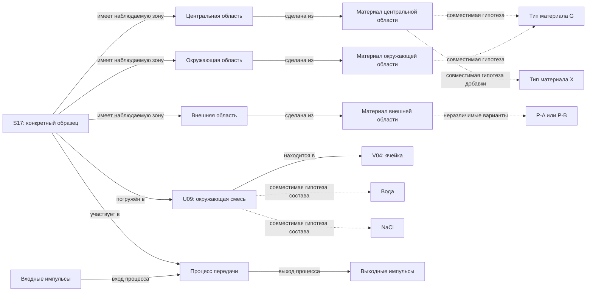

# Что вручную ожидаем увидеть

Эта разметка не передаётся будущему Сталкеру. Это один содержательный вариант
результата для полного ручного маршрута; точные названия и число узлов не заданы.
Ожидания условны: без соответствующего наблюдения ставится «не исследовано»,
а не требуется угадать скрытый ответ.

## 1. Объект раскрывается в нескольких направлениях

Пунктирные связи — объяснения откликов в условной модели эталонов, а не
доказанная уникальная химическая идентификация. Сплошные связи тоже должны иметь
основания и область действия. Общий G не объединяет две физические области
или две порции материала в один объект. Жидкость U09 не становится частью S17.

## 2. У разбиения есть измеренные пределы

Из O01, O02, O03 и D01 ожидаем выделить три зоны внутри наблюдаемого внешнего
контура. Границы лежат в интервалах (3.9, 4.1), (62.4, 62.6) и
(124.9, 125.1) мкм. Это два сечения, а не доказательство одинакового строения
на всей длине. Центральную область можно назвать сердцевиной, но оптическую
функцию этого названия наблюдение профиля само по себе не доказывает.

Граница между зонами может быть ребром, объектом или адресуемым участком
профиля. Группировка внутренних зон в дополнительное «волокно» допустима;
требовать единственного дерева вложенности не будем.

## 3. Новый материал остаётся отдельным вопросом

По O04 и O05 отклики двух внутренних областей различны. При условии D01 и
эталонах D02 для центра подходит смесь G/X, для окружающей области — G.
Нужны вопросы о составе и распределении добавки, а не объявление двух разных
областей одинаковой сущностью.

Для O06 эталоны P-A и P-B совпадают во всех пяти каналах. На основном этапе
правильный результат — оба варианта либо явная неустановленность. Выбор P-B
без дополнительного основания не становится лучше от совпадения со скрытым миром.

## 4. Объект сохраняет идентичность при изменении условий

| Эпизод | Температура образца | Задержка вход → выход | Основания |
| --- | ---: | ---: | --- |
| state-0 | 20 °C | 5.000 ns | O08 |
| state-1 | 40 °C | 5.010 ns | A01, O09 |
| state-2 | 20 °C | 5.000 ns | A02, O10 |

Это один S17, несколько состояний и процесс с ролями входа/выхода. Механизм
изменения не установлен. Температуры ячейки и образца менялись вместе: прямо
приписывать эффект оптическому действию химического состава жидкости нельзя.

## 5. Источники имеют собственную область действия

D03 относится к типовой модели M7. Утверждения о сухом воздухе и покрытии P-A
не переносятся автоматически на S17. Видимое содержимое ячейки и его собственный
отклик исследуются отдельно. Документ при этом не объявляется ложным для всех M7.

После D00-B и D04 ожидаем изменение уже существующего вопроса о внешнем материале:
«изготовитель сообщает P-B для S17». Измерение O06 всё ещё не различает A/B.
Документ не становится независимым химическим измерением, прежние данные остаются.

## 6. Открытые вопросы — часть ожидаемого результата

* Что находится между двумя измеренными сечениями?
* Как распределена добавка внутри пятна измерения?
* Какие материалы вне библиотеки могут объяснить те же отклики?
* Какой механизм связывает изменение условий и время передачи?
* Каким независимым действием можно различить P-A и P-B?

Эти вопросы не предписывают неизменный список будущих исследований. Дополнительные
обоснованные объекты и связи допустимы. Число узлов не используется как награда.

Машинно читаемые ожидания: `expectations.json`. Один пример отчёта:
`manual-example.json`. Ни один из них не является результатом рабочего алгоритма.
